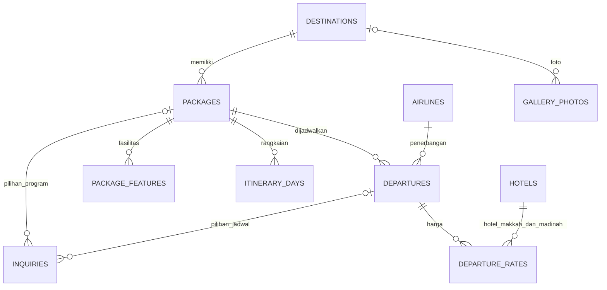

# Rofiq Tour

Website travel umroh menggunakan **Laravel 13, PHP 8.3+, Blade, CSS native, JavaScript ringan, dan Vite**. Banner keunggulan dapat diubah melalui menu admin **Banner keunggulan**. Konten berasal dari database dan dikelola melalui panel admin. Fokus aplikasi saat ini adalah katalog perjalanan, informasi, dan konsultasi calon jamaah.

## Menjalankan aplikasi

Setelah mengikuti langkah instalasi di bawah, jalankan dari root proyek:

```powershell
cd "C:\laragon\www\Rofiq Tour"
npm run dev-all
```

- Website: http://127.0.0.1:8012
- Admin: http://127.0.0.1:8012/admin
- Vite/HMR: http://127.0.0.1:5174
- Tekan **Ctrl+C** untuk menghentikan keduanya.
- Startup menjalankan migrasi yang belum diterapkan melalui `predev-all`, kemudian script memakai `concurrently --kill-others`: jika satu proses berhenti, proses lainnya ikut dihentikan.
- Port 8000 dan 5173 tidak digunakan karena sudah dipakai aplikasi lain saat implementasi.
- Jika mengubah port Laravel, sesuaikan script dan `APP_URL` di `.env`. Konfigurasi port Vite ada di `vite.config.js`.
- Alternatif: `php artisan serve --host=127.0.0.1 --port=8012` dan `npm run dev` pada dua terminal.

Akun admin lokal dibuat dengan kata sandi acak. Kredensialnya ada di **LOCAL_ACCESS.txt**, yang diabaikan Git. Setelah masuk, buka **Keamanan akun** untuk mengganti kata sandi. Tidak ada akun admin/password bawaan yang dibuat oleh seeder.

## Instalasi dari checkout baru

```powershell
composer install
Copy-Item .env.example .env
php artisan key:generate
New-Item database/database.sqlite -ItemType File
php artisan migrate
php artisan db:seed
php artisan storage:link
npm ci
npm run build
php artisan rofiq:admin admin@example.com
npm run dev-all
```

Jangan menimpa `.env`, database, atau mengganti APP_KEY pada instalasi yang sudah berisi data. `rofiq:admin` meminta kata sandi secara tersembunyi dan menolak email yang sudah digunakan.

## Fitur yang tersedia

### Website publik

- Beranda dengan marquee logo maskapai, carousel keunggulan, sosial media Instagram, program, jadwal dengan tab bulan/filter destinasi/harga tiap kelas, fasilitas, cara daftar, FAQ, artikel, dan CTA. Efek reveal dan hover mengikuti pengaturan reduced motion.
- Katalog dengan pencarian, filter destinasi/bulan, dan pagination.
- Detail paket: fasilitas termasuk/belum termasuk, gambaran perjalanan, jadwal, harga kelas Silver/Platinum dan kamar quad/triple/double, maskapai, hotel, serta DP.
- Artikel dengan pencarian/kategori dan halaman detail.
- FAQ yang mencari pertanyaan **dan jawaban**, termasuk kata seperti vaksin.
- Galeri dengan filter destinasi dan lightbox yang bisa ditutup lewat Escape.
- Profil perusahaan, kontak kantor, tautan Google Maps, dan kebijakan privasi.
- Form konsultasi: validasi, persetujuan penggunaan data, pencatatan database, konfirmasi, dan tautan WhatsApp berisi konteks paket/jadwal.
- Logo resmi `public/Logo.webp` dan favicon `public/favicon.ico`.
- Identitas awal: kantor Banjarmasin dan WhatsApp 6289620339209 sesuai informasi pemilik.

### Panel admin

Ringkasan dan CRUD untuk paket, destinasi, maskapai, hotel, keberangkatan, harga/hotel tiap kelas kamar, artikel, FAQ, galeri, kantor, dan testimoni. Permintaan konsultasi memiliki status tindak lanjut dan catatan internal. Identitas website serta kata sandi admin dapat diubah.

Paket dan jadwal contoh sengaja disediakan untuk pengembangan. Tidak ada testimoni, rating perusahaan, atau nomor legalitas palsu yang dipublikasikan. Ubah data contoh menjadi penawaran resmi sebelum peluncuran.

## Arsitektur

Aplikasi mengikuti struktur Laravel dengan alur **Route → Form Request → Controller → Model/Service → Blade**. Eloquent menangani relasi dan query; tidak ada repository/interface tambahan untuk operasi CRUD sederhana.

```text
app/
  Admin/ContentRegistry.php       Definisi modul admin yang diizinkan
  Http/
    Controllers/
      SiteController.php          Halaman publik dan pencarian
      InquiryController.php       Pengiriman dan konfirmasi konsultasi
      Admin/                      Login, dashboard, konten, keamanan akun
    Requests/                     Validasi input publik/admin
    Middleware/EnsureAdmin.php    Pembatasan akses admin
  Models/                         Entitas dan relasi Eloquent
  Services/WhatsApp.php            Penyusunan pesan; tidak mengirim otomatis
  Support/                        Format uang dan URL media
database/
  migrations/                     Struktur, indeks, FK, dan batasan data
  seeders/
    SiteSettingsSeeder.php        Identitas/kantor awal, aman dijalankan ulang
    DatabaseSeeder.php            Program contoh hanya local/testing
resources/
  views/
    layouts/                      Shell publik dan admin
    components/                   Brand, icon, kartu paket/artikel/jadwal
    pages/                        Halaman publik
    admin/                        Halaman administrasi
  css/
    tokens.css                    Warna, font, ukuran dasar
    fonts.css                     Font lokal
    site.css                      Entry CSS publik
    base.css                      Layout dan responsive dasar
    sections.css                  Maskapai, carousel, sosial, jadwal
    motion.css                    Efek hover, float, dan reduced motion
    admin.css                     Tampilan admin
  js/site.js                      Entry menu, lightbox, dan formulir
  js/motion.js                    Reveal lewat IntersectionObserver
  js/carousel.js                  Marquee dan carousel yang dapat dijeda
  js/schedule.js                  Filter bulan/program dan tampilkan semua
  fonts/                          Font self-hosted
public/
  Logo.webp                       Logo pemilik
  favicon.ico                     Favicon pemilik
  images/                         Foto ilustrasi destinasi
routes/
  web.php                         Route bernama
  console.php                     Perintah membuat admin
tests/Feature/                    Pengujian aplikasi dan database
```

### Menambah fitur

1. Buat migrasi/model dengan Artisan, tetapkan FK, indeks, dan aturan delete.
2. Letakkan validasi input pada Form Request.
3. Tambahkan controller khusus jika fitur memiliki alur bisnis tersendiri.
4. Untuk CRUD editorial sederhana, tambahkan modul ke `ContentRegistry`: model, label, kolom, field, aturan validasi, dan opsi relasi.
5. Gunakan service/action khusus bila operasi mencakup beberapa entitas, proses eksternal, atau transaksi.
6. Tambahkan route bernama dan Blade; gunakan komponen yang sudah ada.
7. Tambahkan pengujian untuk perilaku dan otorisasi yang baru.

Registry admin merupakan allowlist internal, bukan nama model/tabel yang berasal dari input pengguna. Akun pengguna dan tabel sensitif lain tidak dapat dibuka lewat parameter URL modul.

## Database dan integritas data

### Relasi utama



Tabel lain: `articles`, `faqs`, `offices`, `testimonials`, `site_settings`, serta tabel standar Laravel untuk users/session/cache/jobs.

- **Paket** adalah program/produk. Tanggal dan durasi ditempatkan pada **keberangkatan** agar satu paket memiliki banyak jadwal.
- **Harga** dimiliki keberangkatan, bukan hardcoded dalam Blade. Satu kombinasi jadwal + kelas + tipe kamar memiliki satu harga.
- **Hotel** merupakan master terpisah dan direferensikan dari harga kelas/kamar. Validator memeriksa kota hotel Makkah dan Madinah.
- **Uang** berupa integer rupiah, bukan float. Harga harus positif; DP tidak boleh negatif.
- **Seat** terdiri dari kapasitas dan jumlah tersedia. Batasan database memastikan 0 ≤ tersedia ≤ kapasitas.
- **Konsultasi** memakai UUID referensi, status, consent timestamp, dan relasi paket/jadwal opsional.
- **Artikel** terbit jika waktu publikasinya sudah tiba. Paket draft dan jadwal lampau/dibatalkan tidak ditampilkan sebagai penawaran aktif.
- Slug unik, FK, composite unique indexes, dan indeks tanggal/status melindungi konsistensi serta query utama.
- Paket dan keberangkatan menggunakan soft delete untuk mempertahankan histori. Inquiry dapat membaca relasi yang telah diarsipkan.
- Data master yang masih direferensikan dilindungi `restrictOnDelete`.
- Pengubahan fasilitas/itinerary paket dilakukan dalam transaksi.
- SQLite memakai trigger untuk batasan bisnis; MySQL 8.0.16+ memakai CHECK constraints.
- Database default lokal adalah **SQLite** dengan foreign keys aktif. Migrasi MySQL disediakan, tetapi koneksi MySQL live belum diuji di lingkungan ini.

### Menggunakan MySQL

Buat database **baru** melalui Laragon/phpMyAdmin, misalnya `rofiq_tour`, dengan charset `utf8mb4`. Ubah `.env`:

```dotenv
DB_CONNECTION=mysql
DB_HOST=127.0.0.1
DB_PORT=3306
DB_DATABASE=rofiq_tour
DB_USERNAME=your_database_user
DB_PASSWORD=your_database_password
```

Kemudian:

```powershell
php artisan config:clear
php artisan migrate
php artisan db:seed
php artisan rofiq:admin admin@example.com
```

Perintah ini membangun database baru; **tidak memindahkan data SQLite lama secara otomatis**. Untuk memindahkan data yang sudah dipakai, lakukan ekspor/impor terencana, backup dahulu, dan verifikasi referensi/ID serta jumlah record. Jangan memakai `migrate:fresh` pada database yang berisi data operasional.

## Keamanan dan batas fungsional

- Login menggunakan session Laravel dan hash password; session diregenerasi saat login.
- Semua route admin membutuhkan autentikasi dan flag `is_admin`.
- CSRF protection Laravel untuk form; rate limit untuk login dan konsultasi.
- Form Request membatasi field, format telepon, ukuran file, jadwal, relasi, dan consent.
- Blade meng-escape konten. Artikel ditulis sebagai teks, bukan HTML bebas.
- Upload dibatasi JPG/PNG/WebP, maksimal 5 MB dan dimensi 6000×6000. File memakai nama acak pada storage public.
- Data konsultasi hanya dapat dibaca admin atau sesi pengirim melalui halaman konfirmasi.
- Form konsultasi menyimpan permintaan, **belum membuat booking/pembayaran atau mengunci seat**. Seat diperbarui manual oleh admin.
- Kode ini belum menyediakan payment gateway, portal jamaah/TL, kampanye upload bukti, verifikasi legalitas, dan sinkronisasi seat otomatis.
- Jika booking ditambahkan, pisahkan tabel bookings/travelers/payments; gunakan transaksi dan row locking untuk mencegah overselling.
- Definisikan kebijakan retensi/backup dan proses penghapusan konsultasi sebelum penggunaan operasional skala besar.

## Pengujian dan build

```powershell
php artisan test --compact
npm run test:frontend
php vendor/bin/pint --format agent
npm run build
php artisan view:cache
php artisan route:cache
```

Cakupan: halaman publik/admin, publikasi, filter, jadwal lampau, pencarian FAQ, konsistensi seeder, validasi/sesi konsultasi, pembatasan admin, login/logout, perubahan password, CRUD fasilitas, file upload, FK, harga unik, format tanggal, dan batas kapasitas database.

## Deployment

1. Gunakan PHP 8.3+ dengan extension yang dibutuhkan Laravel dan MySQL 8.0.16+ atau SQLite yang sesuai.
2. Document root web server harus menunjuk ke **public/**, bukan root proyek.
3. Buat environment production dengan APP_DEBUG=false, APP_URL domain HTTPS, APP_KEY sendiri, kredensial database sendiri, dan SESSION_SECURE_COOKIE=true.
4. Jalankan `composer install --no-dev --optimize-autoloader`, `npm ci`, dan `npm run build`.
5. Backup database sebelum `php artisan migrate --force`. Seeder production hanya membuat identitas/kantor awal, tanpa program contoh.
6. Jalankan `php artisan storage:link`, `php artisan optimize`, dan buat admin secara eksplisit.
7. Pastikan storage/ dan bootstrap/cache/ dapat ditulis. Jangan mengunggah LOCAL_ACCESS.txt.
8. Periksa nomor kontak, data paket, gambar, kebijakan, dan informasi legalitas yang benar sebelum publikasi.

Laravel Boost dipasang sebagai dependensi development sesuai panduan skeleton Laravel. Tidak dibutuhkan untuk melayani website production.

## Aset dan riset

Logo/favicon berasal dari pemilik. Ilustrasi umroh, jamaah ihram, Makkah, Madinah, manasik, hotel, dan mockup sosial media tersedia di `public/images/umroh` dan `public/images/features`. Prompt dan asal pembuatan dicatat pada `prompts.json` di masing-masing folder. Gambar merupakan ilustrasi, bukan dokumentasi jamaah atau bukti fasilitas Rofiq Tour.

Logo maskapai beserta sumber aset dicatat di `public/images/airlines/sources.json`. Aset foto stok lama disimpan sebagai referensi dan tidak digunakan pada konten awal website. Font DM Sans dan Manrope di-host lokal dengan berkas lisensinya di `resources/fonts`.

Riset referensi desain tersedia di `docs/reference-payungmadinah/RESEARCH.md`. Website menggunakan identitas dan konten Rofiq Tour.
